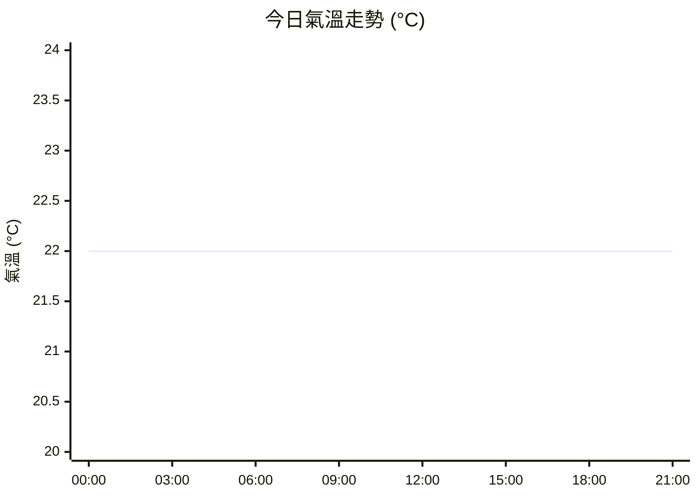

# 🌧️ Chouwei 氣象詳細報告

> 📍 **地區**：T'ai-pei, Taiwan (Chouwei) [經緯度: 25.050, 121.567]
> 🕒 **報告產生時間**：2026/11/7 10:14:42 [GMT+8]
> 🌐 **資料來源**：wttr.in / WorldWeatherOnline

## 📌 即時氣象概況

| 觀測項目 | 數值 | 觀測項目 | 數值 |
| :--- | :--- | :--- | :--- |
| **天氣狀態** | 🌧️ 毛毛細雨 | **即時氣溫** | **22°C** (72°F) |
| **體感溫度** | **23°C** | **相對濕度** | 87% |
| **降雨量** | 0.2 mm | **大氣壓力** | 1024 hPa |
| **風向風速** | E (85°) / 15 km/h | **紫外線指數** | 0 (低量級) |
| **能見度** | 2 km | **雲量覆蓋** | 100% |
| **日出時間** | 🌅 06:05 AM | **日落時間** | 🌇 05:10 PM |
| **月相狀態** | 🌙 Waning Crescent | **月光照射度** | 5% |

## 💡 貼心生活指南

- 🧥 **穿衣建議**：略有涼意，建議著長袖上衣、針織衫或風衣外套。
- ☂️ **外出提醒**：目前有降雨現象（毛毛細雨，累積約 0.2 mm），外出請務必攜帶雨具並注意路面濕滑。
- 🌡️ **今日氣溫走勢**：預計最高溫 **24°C**，最低溫 **22°C**，日照時間約 **3.0 小時**。

## 🕒 今日逐時天氣預報

> 💡 *註：天氣預報與觀測數值會因資料來源不同而有些微差異，僅供參考。*

| 時間 | 天氣 | 氣溫 | 體感 | 降雨機率 | 降雨量 | 濕度 | 風速 |
| :---: | :---: | :---: | :---: | :---: | :---: | :---: | :---: |
| 00:00 | 🌧️ Patchy rain nearby | 22°C | 25°C | 36% | 0.1 mm | 85% | 15 km/h |
| 03:00 | 🌧️ Patchy rain nearby | 22°C | 22°C | 36% | 0.1 mm | 87% | 14 km/h |
| 06:00 | 🌧️ Patchy rain nearby | 22°C | 25°C | 37% | 0.1 mm | 87% | 15 km/h |
| 09:00 | 🌧️ 毛毛細雨 | 22°C | 25°C | 48% | 0.2 mm | 87% | 15 km/h |
| 12:00 | 🌧️ Patchy rain nearby | 22°C | 25°C | 39% | 0.1 mm | 87% | 16 km/h |
| 15:00 | 🌧️ Patchy rain nearby | 22°C | 25°C | 34% | 0.1 mm | 83% | 21 km/h |
| 18:00 | 🌧️ Patchy rain nearby | 22°C | 22°C | 25% | 0.0 mm | 81% | 23 km/h |
| 21:00 | 🌧️ Patchy rain nearby | 22°C | 22°C | 22% | 0.0 mm | 81% | 22 km/h |

### 📈 今日氣溫走勢圖

## 📅 未來多日天氣趨勢

| 日期 | 最低溫 / 最高溫 | 平均氣溫 | 紫外線指數 | 日出 / 日落 |
| :---: | :---: | :---: | :---: | :---: |
| **2026-11-07** | 🌡️ 22°C ~ 24°C | 22°C | 1 (低量級) | 🌅 06:05 AM / 🌇 05:10 PM |
| **2026-11-08** | 🌡️ 20°C ~ 28°C | 24°C | 7 (高量級) | 🌅 06:05 AM / 🌇 05:10 PM |
| **2026-11-09** | 🌡️ 17°C ~ 23°C | 20°C | 1 (低量級) | 🌅 06:06 AM / 🌇 05:09 PM |

---
*本報告由天氣小助手自動擷取生成。*
